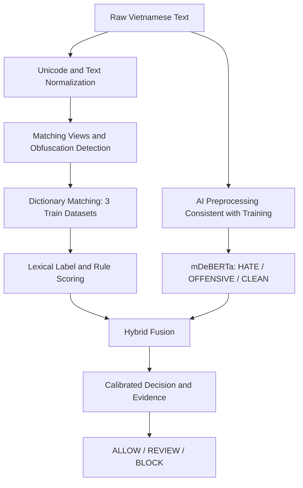

# SensitiveAI — Bổ sung kế hoạch Rule Engine và Hybrid Scoring

> Phần mở rộng cho kế hoạch *SensitiveAI — Research, Training & Evaluation Plan*. Giữ nguyên 4 mô hình và các quy tắc split, validation, test của kế hoạch gốc.

## 35. Mục tiêu Rule Engine

Xây dựng một Rule Engine độc lập để phát hiện từ/cụm từ nhạy cảm trong tiếng Việt, gồm: gán nhãn cho từng mục từ đã trích xuất, chuẩn hóa đầu vào, chống lách luật, đối chiếu từ điển từ ba dataset, chấm điểm bằng mã nguồn và kết hợp với dự đoán AI. Rule Engine cần trả về bằng chứng có thể giải thích: vị trí khớp, dạng gốc, dạng chuẩn hóa, nhãn, quy tắc kích hoạt và điểm.

**Phân biệt hai mức nhãn:** Nhãn của một mục từ/cụm từ là tín hiệu từ vựng; nhãn `HATE`, `OFFENSIVE`, `CLEAN` của mô hình là phân loại **toàn bộ nội dung**. Một từ xuất hiện không đủ để kết luận cả câu vi phạm.

## 36. Xây dựng từ điển từ 3 dataset

### 36.1. Nguồn và chống rò rỉ dữ liệu

- Dataset 1: ViHSD; dataset 2 và 3: cấu hình tên, phiên bản, nguồn, giấy phép và schema khi được xác định.
- Chỉ trích xuất/điều chỉnh từ điển từ **training split** của mỗi dataset. Không sử dụng validation/test để thêm từ, chọn trọng số hay sửa quy tắc.
- Chuẩn hóa nhãn giữa dataset bằng bảng mapping được duyệt thủ công. Không mặc định rằng nhãn câu của dataset chính là nhãn của từng từ.
- Lưu provenance: dataset, split, record ID, phiên bản extraction, tần suất xuất hiện trong ngữ cảnh vi phạm và sạch. Loại bỏ dữ liệu nhận dạng cá nhân không cần thiết.
- Đối với các từ đã extract trước đó: đối chiếu nguồn và split; nếu không xác minh được, không sử dụng trong thí nghiệm đánh giá chính.

### 36.2. Gán nhãn cho từng từ/cụm từ

Quy trình: extract candidates → hợp nhất biến thể → xem ngữ cảnh nguồn → gán nhãn → kiểm duyệt các trường hợp mơ hồ → đóng băng phiên bản từ điển.

Đề xuất schema:

```json
{
  "entry_id": "lex_0001",
  "term": "<cum_tu_nhay_cam>",
  "canonical_form": "<dang_chuan>",
  "lexical_labels": ["OFFENSIVE"],
  "severity": 0.65,
  "confidence": 0.9,
  "context_required": true,
  "source_datasets": ["dataset_1"],
  "source_split": "train",
  "review_status": "verified",
  "dictionary_version": "v1"
}
```

- Có thể cho phép nhiều nhãn từ vựng nếu một cụm từ có nhiều nghĩa; chỉ dùng `HATE/OFFENSIVE` khi có căn cứ ngữ cảnh. `CLEAN` nên được hiểu là trạng thái không vi phạm của toàn câu, không phải mặc định một nhãn từ cấm.
- Nhãn có thể được đề xuất tự động bằng heuristic/AI, nhưng mục từ mơ hồ hoặc có tác động lớn phải được kiểm tra thủ công. Ghi tỷ lệ đồng thuận giữa người gán nhãn nếu có từ hai người trở lên.
- Từ có thể xuất hiện trong câu trích dẫn, phản đối hành vi thù ghét, hoặc thảo luận giáo dục; dùng `context_required=true` để tránh chặn cứng.

## 37. Chuẩn hóa ký tự đầu vào

Pipeline thống nhất và có thể cấu hình:

1. Lưu `raw_text` không thay đổi.
2. Chuẩn hóa Unicode (NFC), chuẩn hóa dấu cách, xuống dòng, tab, chữ hoa/thường.
3. Xử lý các ký tự vô hình, zero-width, dấu kéo dài và lặp ký tự có giới hạn.
4. Tạo `normalized_text` và ánh xạ offset về `raw_text` để chỉ rõ từ bị phát hiện.
5. Tạo thêm các *matching views* có kiểm soát (không thay thế bản gốc dùng cho AI).

Không tự động xóa dấu tiếng Việt hoặc gộp mọi ký tự nhìn giống nhau trong bản chính vì có thể làm thay đổi nghĩa. Nếu tạo bản không dấu hoặc ánh xạ ký tự tương tự, chỉ dùng như tín hiệu đối chiếu phụ và đánh giá riêng false positives.

## 38. Chống lách luật (Obfuscation Detection)

Nhận diện các cách viết né lọc: chèn khoảng trắng/dấu câu giữa ký tự, ký tự Unicode tương tự, zero-width, lặp chữ, thay chữ bằng số/ký hiệu, viết không dấu và cố tình tách từ.

Áp dụng nhiều cấp:

- Exact match trên bản chuẩn hóa.
- Variant match dựa trên alias được xác minh trong từ điển.
- Fuzzy match có giới hạn khoảng cách chỉnh sửa, độ dài tối thiểu và điều kiện ngữ cảnh.
- Pattern match bằng regex có ranh giới từ phù hợp tiếng Việt; tránh khớp chuỗi con tùy tiện.

Mỗi match lưu `match_type`, `transformation_trace`, `start/end offsets` và `confidence`. Hạn chế số biến thể, độ dài đầu vào và thời gian xử lý để tránh chi phí quá lớn. Không cộng điểm nhiều lần cho cùng một span chỉ vì khớp nhiều biến thể.

## 39. Đối chiếu từ điển và chấm điểm Rule Engine

Với mỗi match, xét: độ nghiêm trọng của nhãn, độ tin cậy mục từ, độ tin cậy kiểu khớp, ngữ cảnh phủ định/trích dẫn và mức độ lặp lại. Trọng số là **giả thuyết khởi tạo**, phải hiệu chỉnh trên validation set.

Ví dụ cấu hình khởi tạo:

| Tín hiệu | Giá trị minh họa |
|---|---:|
| Severity HATE | 0.90 |
| Severity OFFENSIVE | 0.60 |
| Exact match factor | 1.00 |
| Verified alias factor | 0.90 |
| Fuzzy match factor | 0.60 |

`match_score = severity × entry_confidence × match_factor × context_factor`.

Tổng hợp nhiều match bằng phương pháp có giới hạn, ví dụ `rule_score = 1 - product(1 - match_score_i)` sau khi khử trùng lặp và giới hạn số match. Công thức này chỉ là điểm heuristic, **không phải xác suất đã được hiệu chuẩn**. Để phục vụ fusion theo nhãn, xuất `rule_hate_score`, `rule_offensive_score` và `rule_score` trong [0,1].

Kết quả ví dụ:

```json
{
  "rule_score": 0.72,
  "rule_hate_score": 0.12,
  "rule_offensive_score": 0.72,
  "matches": [{
    "entry_id": "lex_0001",
    "label": "OFFENSIVE",
    "match_type": "verified_alias",
    "score": 0.72,
    "raw_span": "<chuoi_goc>",
    "normalized_span": "<chuoi_chuan>",
    "start": 10,
    "end": 22
  }],
  "dictionary_version": "v1"
}
```

## 40. AI Inference và Hybrid Fusion

AI giữ nguyên 3 xác suất `P(HATE)`, `P(OFFENSIVE)`, `P(CLEAN)` từ một trong bốn mô hình đã huấn luyện. Chạy song song với Rule Engine, ưu tiên cung cấp cả raw text và normalized text phù hợp với pipeline training; không tự ý thay đổi preprocessing của model khi inference.

**Baseline fusion đơn giản** (trọng số ví dụ, tune trên validation):

- `hybrid_hate = alpha * P(HATE) + (1-alpha) * rule_hate_score`
- `hybrid_offensive = alpha * P(OFFENSIVE) + (1-alpha) * rule_offensive_score`
- `alpha` ban đầu có thể thử 0.5, 0.7, 0.9; chọn theo validation macro-F1, per-class recall và false-positive rate.
- Không coi hai hybrid score là phân phối xác suất 3 lớp. Muốn có `P(CLEAN)` cuối cùng và tổng bằng 1, cần một bước hiệu chuẩn/meta-classifier riêng được fit trên validation hoặc dữ liệu calibration tách riêng.
- Có thể thử thêm logistic regression/meta-classifier với input gồm ba xác suất AI, hai điểm rule và số lượng/kiểu match; huấn luyện bằng dữ liệu không rò rỉ, đánh giá test một lần sau khi đóng băng.

**Decision layer:** Áp dụng nhãn dự đoán/threshold đã hiệu chỉnh. Nếu cần hành động kiểm duyệt, thử ba trạng thái `ALLOW`, `REVIEW`, `BLOCK`; không đánh đồng với nhãn phân loại. Trường hợp fuzzy match hoặc từ phụ thuộc ngữ cảnh nên ưu tiên REVIEW thay vì BLOCK tự động.

## 41. Pipeline tích hợp



## 42. Tổ chức source code bổ sung

```text
SensitiveAI/
├── data/
│   └── lexicon/
│       ├── candidates_train.csv
│       ├── verified_lexicon.csv
│       ├── label_mapping.yaml
│       └── provenance.json
├── src/
│   ├── rule_engine/
│   │   ├── normalize.py
│   │   ├── obfuscation.py
│   │   ├── matcher.py
│   │   ├── lexical_classifier.py
│   │   ├── scoring.py
│   │   └── engine.py
│   └── fusion/
│       ├── weighted_fusion.py
│       ├── calibration.py
│       └── decision.py
├── configs/
│   ├── rule_engine.yaml
│   └── hybrid_fusion.yaml
├── scripts/
│   ├── build_lexicon.py
│   ├── validate_lexicon.py
│   └── evaluate_hybrid.py
└── evaluation/
    └── hybrid/
        ├── ablation_results.csv
        ├── per_class_metrics.csv
        ├── false_positive_analysis.csv
        └── obfuscation_robustness.csv
```

## 43. Thí nghiệm và Ablation Study

So sánh trên **cùng test set cố định**:

1. Rule Engine only.
2. AI only (từng model trong 4 model).
3. AI + exact dictionary matching.
4. AI + normalization + exact matching.
5. AI + normalization + anti-obfuscation + lexical labels + scoring.
6. Full hybrid fusion (weighted hoặc meta-classifier).

Báo cáo Accuracy, Macro-F1, Weighted-F1, Precision/Recall/F1 theo nhãn, confusion matrix 3×3, PR/ROC khi có score thích hợp, false-positive rate trên CLEAN, recall trên mẫu bị làm nhiễu, latency/FPS và tỷ lệ REVIEW/BLOCK nếu triển khai decision layer. Tạo tập đánh giá robustness từ **test gốc** bằng biến đổi định trước, không dùng nó để tune; báo cáo riêng kết quả clean và obfuscated, tránh trộn làm sai so sánh với kế hoạch ban đầu.

Thử nghiệm riêng độ chính xác gán nhãn từ vựng (lexicon annotation agreement/precision trên tập từ được gán nhãn độc lập), bởi nhãn toàn câu không phải ground truth cho từng từ.

## 44. Quy tắc tái lập và tiêu chí hoàn thành

- Ghi hash và phiên bản của 3 dataset, train/validation/test split, từ điển, mapping nhãn, rule config, model checkpoint và fusion config.
- Chỉ cập nhật từ điển và trọng số trên train/validation; đóng băng trước final test.
- Test bảo đảm offset mapping chính xác, không mất dấu tiếng Việt, không match nhầm chuỗi con, không double count, không lỗi khi text rỗng hoặc rất dài.
- Báo cáo trường hợp rule và AI bất đồng; đo false positives ở ngữ cảnh trích dẫn, phủ định, giáo dục.
- Không tuyên bố tăng độ chính xác nếu chưa có kết quả thực nghiệm và kiểm định phù hợp.
- Đầu ra cuối cùng: verified lexicon, Rule Engine độc lập, Hybrid Scoring module, báo cáo ablation, biểu đồ và bảng paper-ready.
