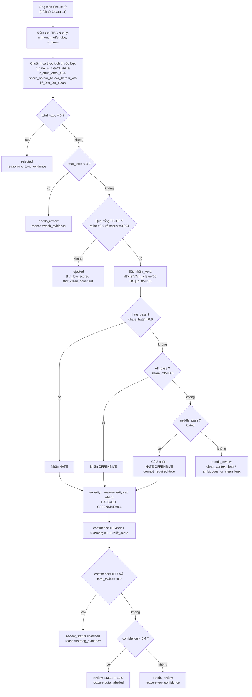
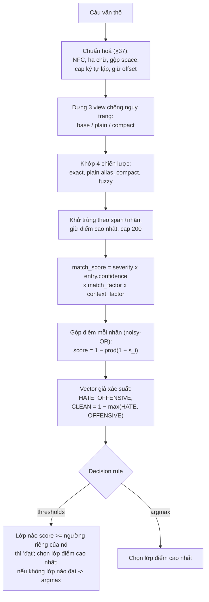

# Giải thích: Gán nhãn từ điển & Rule Engine

> Tài liệu này giải thích **hai câu hỏi**:
> 1. `confidence` trong file CSV được tính thế nào, và làm sao quyết định một từ vào **HATE** hay **OFFENSIVE**?
> 2. Rule engine quyết định một **câu văn** thuộc lớp nào bằng thuật toán gì?
>
> Mọi số liệu lấy trực tiếp từ code trong `src/data/lexical_labeler.py`,
> `src/rule_engine/*.py`, `src/evaluation/metrics.py`, `src/evaluation/thresholds.py`.

---

## PHẦN A — Gán nhãn từ điển (`confidence` + HATE/OFFENSIVE)

### A.0 Ý tưởng cốt lõi
Mỗi ứng viên (từ/cụm từ) được đếm **trên tập train** của 3 dataset (ViHSD, ViCM,
bontori). Từ đó suy ra: *từ này gắn với nhãn nào*, *chắc chắn đến đâu*.

> ⚠️ **`confidence` KHÔNG dùng để chọn nhãn.** Nhãn do luật `share + lift` quyết
> định. `confidence` chỉ dùng để xếp trạng thái duyệt (`verified` / `auto` /
> `needs_review`). Đây là điểm dễ nhầm nhất.

### A.1 Sơ đồ toàn bộ quy trình gán nhãn



### A.2 Công thức `confidence` (chi tiết)

```
ev         = min(1, total_toxic / 10)                     # độ lớn bằng chứng
margin     = |share_hate − 0.5| × 2                       # độ "lệch hẳn" về 1 nhãn
lift_score = log1p(min(lift, 100)) / log1p(100)           # lift so với CLEAN, thang log

confidence = 0.4×ev + 0.3×margin + 0.3×lift_score         # clamp [0.05, 0.99]
```

| Thành phần | Trọng số | Ý nghĩa | Bão hoà khi |
|---|---|---|---|
| `ev` evidence | 0.4 | càng nhiều dòng độc hại chứa từ càng chắc | `total_toxic ≥ 10` |
| `margin` | 0.3 | share nghiêng hẳn về 1 nhãn (0 = 50/50, 1 = 100%) | `share_hate ∈ {0,1}` |
| `lift_score` | 0.3 | từ xuất hiện ở nhãn độc hại gấp mấy lần ở CLEAN | `lift ≥ 100` |

Trong đó `lift` là **max lift của các nhãn mà từ được bầu**.

**Ví dụ kiểm chứng với từ `3que`** (`n_hate=5, n_off=4, n_clean=1, total_toxic=9,
share_hate=0.735, lift_hate=43.297` → `confidence=0.7474` trong file CSV):

```
ev         = 9 / 10 = 0.9                 → 0.4 × 0.9   = 0.360
margin     = |0.735 − 0.5| × 2 = 0.47     → 0.3 × 0.47  = 0.141
lift_score = ln(44.297)/ln(101) = 0.8214  → 0.3 × 0.8214 = 0.246
confidence = 0.360 + 0.141 + 0.246        = 0.7474   ✓ khớp CSV
```

### A.3 Cách quyết định HATE vs OFFENSIVE (luật bầu nhãn)

**Bước 1 — chuẩn hoá theo kích thước lớp** (không dùng số đếm thô, vì CLEAN đông
hơn nhiều):

```
r_hate     = n_hate      / N_rows_HATE
r_off      = n_offensive / N_rows_OFFENSIVE
r_clean    = n_clean     / N_rows_CLEAN
share_hate = r_hate / (r_hate + r_off)      # "thuộc về" nhãn nào trong 2 lớp độc hại
share_off  = 1 − share_hate
lift_X     = r_X / r_clean                  # gấp mấy lần so với CLEAN
```

**Bước 2 — điều kiện bầu (`_vote`)**: `lift ≥ 3.0` **và** (`n_clean < 20` **hoặc**
`lift ≥ 15.0`). Điều kiện sau loại các từ chỉ *tình cờ* xuất hiện trong ngữ cảnh
độc hại (ví dụ "content", "thớt").

**Bước 3 — quyết định nhãn**:

| Điều kiện | Kết quả |
|---|---|
| `share_hate ≥ 0.6` và `_vote(lift_hate)` | **HATE** |
| `share_off ≥ 0.6` (tức `share_hate ≤ 0.4`) và `_vote(lift_off)` | **OFFENSIVE** |
| share ở giữa (0.4–0.6) và **cả 2** lift đạt | **cả hai** `HATE;OFFENSIVE`, `context_required=true` |
| không nhãn nào đạt | vào review queue |

→ Nói gọn: **nhãn nào chiếm ≥ 60% tỉ lệ (giữa 2 lớp độc hại) và có lift ≥ 3 so
với CLEAN thì từ thuộc nhãn đó.** Nếu ở giữa thì cả hai (cần ngữ cảnh).

**Bước 4 — `severity`**: bằng mức cao nhất trong các nhãn được bầu
(HATE = 0.9, OFFENSIVE = 0.6).

**Bước 5 — `confidence` (mục A.2) quyết định `review_status`**:
`verified` nếu `conf ≥ 0.7` và `total_toxic ≥ 10`; `auto` nếu `conf ≥ 0.4`; còn lại
`needs_review`.

### A.4 Bảng tham số (đặt tay, tune trên validation sau)

| Tham số | Giá trị | Ý nghĩa |
|---|---|---|
| `min_evidence` | 3 | tối thiểu số dòng độc hại |
| `share_threshold` | 0.6 | ngưỡng tỉ lệ để gán 1 nhãn |
| `clean_lift` | 3.0 | lift tối thiểu so với CLEAN |
| `clean_count_cap` | 20 | veto nếu `n_clean ≥ 20` (trừ khi lift rất cao) |
| `strong_lift` | 15.0 | lift đủ để ghi đè cap trên |
| `verified_confidence` / `verified_evidence` | 0.7 / 10 | ngưỡng trạng thái `verified` |
| `auto_confidence` | 0.4 | ngưỡng trạng thái `auto` |

---

## PHẦN B — Rule engine: quyết định một CÂU thuộc lớp nào

### B.0 Ý tưởng cốt lõi
Rule engine **không tự gán lớp**. Nó xuất 2 điểm `rule_hate_score` và
`rule_offensive_score` ∈ [0, 1]; sau đó một **tầng quyết định dùng chung với các
model AI** biến điểm thành nhãn HATE / OFFENSIVE / CLEAN.

### B.1 Sơ đồ pipeline của rule engine



### B.2 Các hệ số trong công thức điểm

```
match_score = severity(nhãn) × entry.confidence × match_factor × context_factor
```

| Hệ số | Phạm vi | Giá trị |
|---|---|---|
| `severity` | theo **nhãn** (lấy từ config) | HATE 0.9, OFFENSIVE 0.6 |
| `entry.confidence` | theo **từng từ** (từ file CSV) | 0–1 (xem Phần A) |
| `match_factor` | theo **kiểu khớp** | exact 1.0, accentless_alias 0.9 (tuned 0.15), leet 0.8, repeat_collapsed 0.75, separator_inserted 0.8, obfuscated_combined 0.6, fuzzy 0.6 |
| `context_factor` | theo **lần xuất hiện** | trong ngoặc kép ×0.6, bị phủ định ×0.5, `context_required` ×0.85 |

> Điểm cần lưu ý với cô: engine hiện **lấy `severity` theo nhãn từ config**, chưa
> đọc cột `severity` của từng entry trong file CSV (hai giá trị hiện bằng nhau nên
> kết quả tương đương). Chỉ `confidence` mới thực sự là trọng số **riêng mỗi từ**.

### B.3 Gộp điểm: tổng "noisy-OR" bão hoà

```
rule_<label>_score = 1 − ∏(1 − match_score_i)     # trên tối đa 10 match mạnh nhất
```

Càng nhiều từ độc hại khớp thì điểm càng tiến về 1 nhưng không vượt 1. Đây là
điểm **heuristic**, không phải xác suất hiệu chuẩn.

### B.4 Cách ra quyết định lớp (điểm mấu chốt)

Từ 2 điểm, dựng vector 3 lớp giả xác suất:

```python
HATE      = rule_hate_score
OFFENSIVE = rule_offensive_score
CLEAN     = 1 − max(HATE, OFFENSIVE)
```

Rồi áp **decision rule dùng chung với 4 model AI** (`apply_decision_rule`):

| Chế độ | Cách hoạt động |
|---|---|
| `argmax` | chọn lớp có điểm cao nhất |
| `thresholds` (dùng cho kết quả báo cáo) | mỗi lớp có **ngưỡng riêng**; lớp "đạt" khi `score ≥ ngưỡng của nó`; trong các lớp đạt chọn lớp **điểm cao nhất**; nếu **không lớp nào đạt** thì quay về `argmax` |

**Ngưỡng tìm bằng thuật toán `coordinate ascent`** trên tập **validation**:
rời rạc hoá mỗi ngưỡng thành lưới 101 điểm trong [0, 1], mỗi vòng tối ưu lần lượt
từng nhãn (giữ cố định các nhãn còn lại) theo **macro-F1**, lặp tối đa 3 vòng →
đóng băng vào `thresholds.json` → test chỉ chấm **một lần** (plan §44).

### B.5 Ngưỡng đã tune của 2 cấu hình (trong `outputs/evaluation/`)

| Cấu hình | HATE | OFFENSIVE | CLEAN |
|---|---|---|---|
| `rule_engine` (baseline) | 0.85 | 0.00 | 0.41 |
| `rule_engine_tuned` (bản tốt nhất) | 0.64 | 0.00 | 0.68 |

*(Số cập nhật 19/10: tune lại trên validation với lexicon 668 entry. OFFENSIVE = 0.00 là bình thường - lớp này*
*luôn có ít nhất một nhãn đạt nên điểm OFFENSIVE không bao giờ là điểm cao nhất.)*

---

## PHẦN C — Gợi ý cách trình bày cho cô (talking points)

1. **Rule engine là luật từ vựng, không phải học máy.** Không có trọng số nào học
   bằng gradient; tất cả là ngưỡng/hệ số heuristic đặt tay rồi tune trên validation.
2. **Từ điển được "chắt lọc" 3 tầng:** (a) đếm bằng chứng trên train; (b) cổng
   TF-IDF loại từ nhiễu; (c) luật share + lift gán nhãn; những từ mơ hồ đẩy vào
   `review_queue` cho người duyệt.
3. **Mỗi từ có một trọng số riêng (`confidence`)** = kết hợp *lượng bằng chứng* +
   *độ rõ nhãn* + *lift so với CLEAN*. Công thức: `0.4·ev + 0.3·margin + 0.3·lift`.
4. **Nhãn (HATE/OFFENSIVE) chọn theo `share`** đã chuẩn hoá theo kích thước lớp
   (≥ 0.6 → nhãn đó; ở giữa → cả hai), **không** theo `confidence`.
5. **Quyết định lớp của câu** dùng *ngưỡng riêng từng nhãn + argmax fallback*,
   ngưỡng tune bằng *coordinate ascent* trên validation rồi đóng băng cho test.
6. **Kết quả nổi bật:** cấu hình `rule_engine_tuned` (hạ trọng số view không dấu
   0.90 → 0.15) đạt macro-F1 test **0.4927**, cao hơn baseline 0.4356; OFFENSIVE vẫn
   là lớp khó nhất → động lực để **fusion với model AI**.

---

## PHẦN D — Câu hỏi phản biện có thể gặp (chuẩn bị trước)

| Câu hỏi | Trả lời ngắn |
|---|---|
| Ngưỡng 0.6/3.0/20 lấy từ đâu? | Đặt tay theo giả thuyết ban đầu (plan §36/§39), có tune lại trên validation. |
| `lift = 999` nghĩa là gì? | Cơ sở CLEAN bằng 0 → lift vô cực, gán giá trị sentinel 999 (chỉ tham chiếu). |
| Vì sao chọn cả hai nhãn? | Share ở giữa 2 lớp độc hại, từ chỉ độc hại khi có ngữ cảnh → `context_required=true`. |
| Có dùng test để tune không? | Không. Ngưỡng tune trên validation, đóng băng, test chấm 1 lần (plan §44). |
| Rule engine có phải model học không? | Không — là hệ luật từ vựng; sẽ được fusion với 4 model AI ở bước sau. |
| Vì sao baseline khác số entry từ điển (2564 vs 1828)? | Baseline chạy với phiên bản từ điển lớn hơn; 2 cấu hình kia dùng bản gated 1828 entry. |

---

_Nguồn code: `src/data/lexical_labeler.py` (`_confidence` dòng 283, `label_term`
dòng 297), `src/rule_engine/{matcher,scoring,lexical_classifier,engine}.py`,
`src/evaluation/{metrics,thresholds}.py`, `scripts/17_evaluate_rule_engine.py`._
