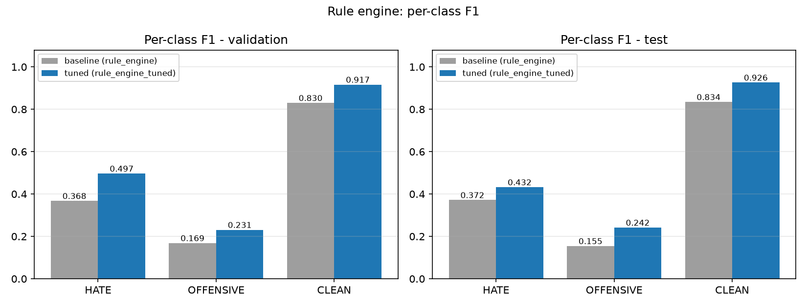
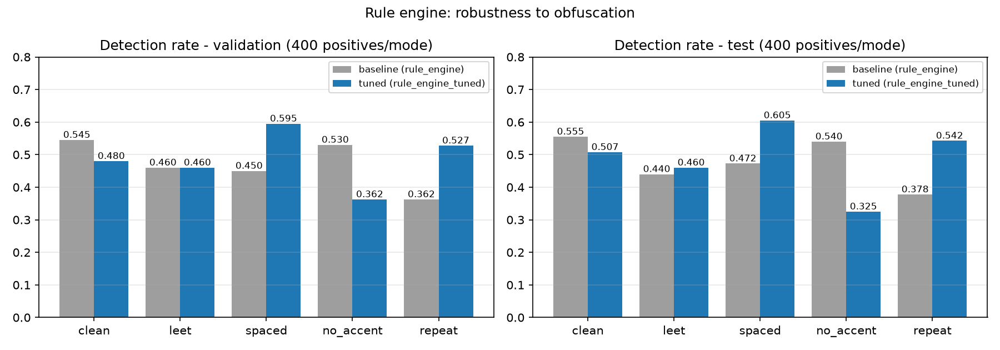
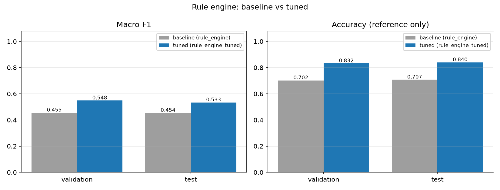

# So sánh 2 rule engine: baseline vs tuned

> Sinh bởi `python scripts/28_compare_rule_engines.py` - **chỉ đọc các artifact đã đóng băng**
> (metrics/robustness/latency/`thresholds.json`), không chấm lại bất kỳ split nào (plan §44).
> Nguồn: `outputs/evaluation/rule_engine/` (baseline, `configs/rule_engine.yaml`) và
> `outputs/evaluation/rule_engine_tuned/` (bản thắng tune, `configs/rule_engine_tuned.yaml`).
> Cùng lexicon `verified_lexicon.csv` 668 entry, cùng validation 2.672 mẫu, test 6.680 mẫu.

## 1. Khác biệt cấu hình

| Tham số | baseline | tuned |
|---|---|---|
| `scoring.match_factors.accentless_alias` | 0.9 | 0 |
| `scoring.match_factors.obfuscated_combined` | 0.6 | 0.45 |
| `scoring.negation_factor` | 0.5 | 1 |
| `thresholds.HATE/OFFENSIVE/CLEAN` (đóng băng) | 0.85 / 0.00 / 0.41 | 0.64 / 0.00 / 0.68 |
| `lexicon_path` | data/processed/lexicon/verified_lexicon.csv | data/processed/lexicon/verified_lexicon.csv |

## 2. Validation (2.672 mẫu - nơi tune)

| Chỉ số | baseline | tuned | Δ (tuned − baseline) |
|---|---|---|---|
| macro-F1 | 0.4555 | 0.5481 | +0.0926 |
| accuracy | 0.7021 | 0.8316 | +0.1295 |
| macro precision | 0.4462 | 0.5852 | +0.1390 |
| macro recall | 0.4821 | 0.5241 | +0.0420 |
| weighted F1 | 0.7309 | 0.8197 | +0.0888 |
| F1 HATE | 0.3677 | 0.4967 | +0.1291 |
| F1 OFFENSIVE | 0.1686 | 0.2310 | +0.0623 |
| F1 CLEAN | 0.8301 | 0.9165 | +0.0864 |

## 3. Test (6.680 mẫu - chấm **một lần**)

| Chỉ số | baseline | tuned | Δ (tuned − baseline) |
|---|---|---|---|
| macro-F1 | 0.4536 | 0.5335 | +0.0799 |
| accuracy | 0.7070 | 0.8398 | +0.1328 |
| macro precision | 0.4495 | 0.5793 | +0.1298 |
| macro recall | 0.4818 | 0.5119 | +0.0302 |
| weighted F1 | 0.7416 | 0.8299 | +0.0883 |
| F1 HATE | 0.3717 | 0.4323 | +0.0606 |
| F1 OFFENSIVE | 0.1546 | 0.2418 | +0.0872 |
| F1 CLEAN | 0.8345 | 0.9263 | +0.0918 |

## 4. Chi tiết per-class trên test (precision / recall / F1 / support)

| Nhãn | Hệ thống | precision | recall | F1 | support |
|---|---|---|---|---|---|
| HATE | baseline (rule_engine) | 0.3410 | 0.4084 | 0.3717 | 688 |
| HATE | tuned (rule_engine_tuned) | 0.5974 | 0.3387 | 0.4323 | 688 |
| OFFENSIVE | baseline (rule_engine) | 0.1106 | 0.2568 | 0.1546 | 444 |
| OFFENSIVE | tuned (rule_engine_tuned) | 0.2361 | 0.2477 | 0.2418 | 444 |
| CLEAN | baseline (rule_engine) | 0.8970 | 0.7801 | 0.8345 | 5548 |
| CLEAN | tuned (rule_engine_tuned) | 0.9044 | 0.9494 | 0.9263 | 5548 |

## 5. Robustness - tỉ lệ phát hiện trên 400 mẫu nhiễu/mode

| Mode | validation baseline | validation tuned | test baseline | test tuned |
|---|---|---|---|---|
| `clean` | 0.5450 | 0.4800 | 0.5550 | 0.5075 |
| `leet` | 0.4600 | 0.4600 | 0.4400 | 0.4600 |
| `spaced` | 0.4500 | 0.5950 | 0.4725 | 0.6050 |
| `no_accent` | 0.5300 | 0.3625 | 0.5400 | 0.3250 |
| `repeat` | 0.3625 | 0.5275 | 0.3775 | 0.5425 |

*Đánh đổi đã biết: tuned giảm `no_accent` (accentless_alias = 0) bù lại leet/spaced/repeat tốt hơn.*

## 6. Độ trễ (validation, 2.672 mẫu)

| Chỉ số | baseline | tuned |
|---|---|---|
| mean ms/mẫu | 0.3770 | 0.3741 |
| p50 ms | 0.2365 | 0.2351 |
| p95 ms | 0.9079 | 0.8702 |
| mẫu/giây | 2652.3 | 2672.9 |

## 7. Kiểm định chênh lệch trên test (paired bootstrap + McNemar)

- Giao thức: 10000 lần bootstrap, seed 42, CI 95%, n = 6680 mẫu test; số liệu gốc: `rule_engine_significance.json` + `papers/tables/rule_significance.tex`.
- **macro_f1**: baseline 0.4536 [0.4390, 0.4681] vs tuned 0.5335 [0.5150, 0.5519] → Δ = +0.0799 CI [0.0598, 0.1002], p < 1e-4.
- **accuracy**: baseline 0.7070 [0.6961, 0.7178] vs tuned 0.8398 [0.8310, 0.8488] → Δ = +0.1328 CI [0.1226, 0.1431], p < 1e-4.
- **McNemar** (đúng/sai từng mẫu): tuned đúng & baseline sai 1132, tuned sai & baseline đúng 245 (đối xứng 1377 mẫu), p = 2.24e-136.
- Kết luận của `scripts/26`: rule_engine_tuned is significantly higher than rule_engine on macro-F1 (p=0.0000)
- Kết luận của `scripts/26`: rule_engine_tuned is significantly higher than rule_engine on accuracy (p=0.0000)

## 8. Kết luận (theo số, có kiểm định - plan §44)

- Test macro-F1: **0.4536** (baseline) vs **0.5335** (tuned) → Δ = +0.0799 (+17.6%).
- Chênh lệch **có ý nghĩa thống kê**: paired bootstrap CI [0.0598, 0.1002] không chứa 0 (p < 1e-4), McNemar p = 2.24e-136.
- Cả hai cùng lexicon 668 entry; khác nhau chỉ ở trọng số scoring + ngưỡng đã tune trên validation.
- Đánh đổi phải nhớ (`robustness.json`): tuned mất recall chế độ `no_accent` (test 0.3250 vs baseline 0.5400) vì `accentless_alias = 0`.
- `F1 OFFENSIVE` thấp ở cả hai (0.24 / 0.15) là bài toán coverage của từ điển, không phải bug; ngưỡng `OFFENSIVE = 0.0` là bình thường.
